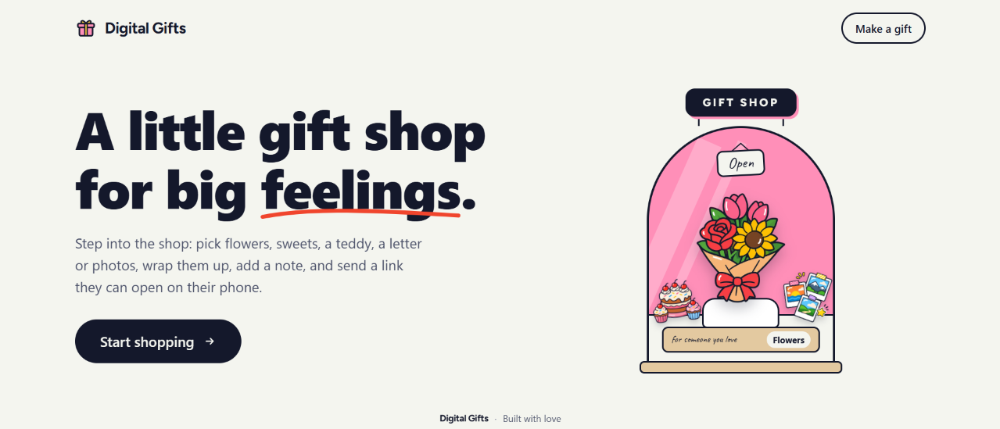
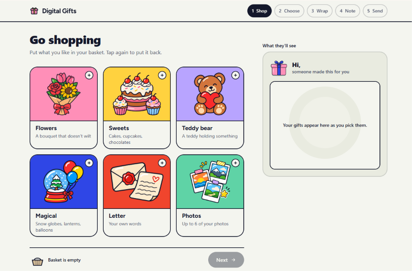
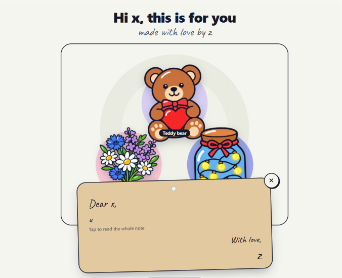

<div align="center">

# 🎁 Digital Gifts

### *Create beautiful, personalized digital gifts for your loved ones*

<br/>


<br/>

> 💌 *Because the best gifts come from the heart — not a shopping cart.*

<br/>

[✨ Live Demo](https://digitalgifts.vercel.app) · [🐛 Report a Bug](https://github.com/yourusername/digitalgifts/issues) · [💡 Request a Feature](https://github.com/yourusername/digitalgifts/issues)

</div>

---

## 📸 Screenshots

<div align="center">

### 🏠 Landing Page — the gift shop


### 🛠️ Gift Builder — go shopping


### 🎀 Gift Reveal — composed gifts and a handwritten note


</div>

---

## 💫 About

**Digital Gifts** is a little online gift shop for big feelings. Step into the shop, fill your basket with digital bouquets, sweet treats, teddy bears, magical items, letters, or cherished photos, wrap them up, add a note, and send a link they can open on their phone. 🌸

---

## ✨ Features

### 🎀 Gift Categories

| 🎁 Category | 📝 Description |
|:-----------:|----------------|
| 💐 **Flowers** | A bouquet that never wilts — Rose, Peony, Wildflower, Tulip, Sunflower |
| 🍫 **Sweet Treats** | Sugar, spice and everything nice — Chocolate Box, Cupcakes, Macarons, Cookie Jar, Cake |
| 🧸 **Teddy Bears** | A hug they can keep forever — Heart, Flower, Balloon, Gift Box variants |
| ✨ **Magical** | A little wonder, just for them — Snow Globe, Floating Balloons, Wishing Lantern, Jar of Stars |
| 💌 **Love Letters** | Words straight from your heart — Parchment Scroll, Sealed Envelope, Open Letter |
| 📷 **Memories** | Upload up to 6 photos with captions — Polaroid Wall, Photo Strip, Scrapbook, Memory Jar |

### 🚀 Core Features

- 🧙 **Multi-Step Gift Builder** — Intuitive 5-step shop journey (Shop → Choose → Wrap → Note → Send)
- 👁️ **Live Preview** — See your gift come together in real-time as you build it
- 🧺 **Shopping Basket** — Pick several gifts and keep them in your basket as you go
- 🎀 **Wrap Step** — Choose how your gift is wrapped before sending
- 🎨 **Multiple Gift Items** — Combine different gift types into one package
- 🎊 **Beautiful Reveal Animation** — Recipients experience a delightful gift unwrapping animation
- 🔗 **Shareable Links** — Each gift gets a unique URL to share with your loved one
- 🖼️ **Photo Memories** — Upload personal photos with captions for the memory gift type
- 📱 **Fully Responsive** — Works beautifully on mobile, tablet, and desktop

---

## 🛠️ Tech Stack

| Layer | Technology |
|-------|------------|
| ⚡ Framework | [Next.js 16](https://nextjs.org/) (App Router) |
| 🔷 Language | [TypeScript](https://www.typescriptlang.org/) |
| 🎨 Styling | [Tailwind CSS 4](https://tailwindcss.com/) |
| 🌀 Animations | [Framer Motion](https://www.framer.com/motion/) |
| 🗄️ Database & Storage | [Supabase](https://supabase.com/) |
| 🚀 Deployment | [Vercel](https://vercel.com/) |

---

## 🏁 Getting Started

### 📋 Prerequisites

- Node.js 18+
- npm, yarn, pnpm, or bun
- A [Supabase](https://supabase.com/) account

### ⚙️ Installation

**1. Clone the repository**
```bash
git clone https://github.com/yourusername/digitalgifts.git
cd digitalgifts
```

**2. Install dependencies**
```bash
npm install
# or
yarn install
# or
pnpm install
```

**3. Set up environment variables**

Create a `.env.local` file in the root directory:
```env
NEXT_PUBLIC_SUPABASE_URL=your_supabase_project_url
NEXT_PUBLIC_SUPABASE_ANON_KEY=your_supabase_anon_key
```

**4. Set up Supabase**

Create the following tables in your Supabase project:

- 🗃️ `gifts` — Stores gift metadata (id, from_name, to_name, message, created_at)
- 🗃️ `gift_items` — Stores individual gift items (id, gift_id, type, content, position)
- 🗃️ `gift_photos` — Stores photo references (id, gift_item_id, storage_path, caption, position)

Create a storage bucket named **`digitalgifts-photos`** for photo uploads.

**5. Run the development server**
```bash
npm run dev
```

**6.** 🎉 Open [http://localhost:3000](http://localhost:3000) in your browser!

---

## 📁 Project Structure

```
digitalgifts/
├── 📂 app/
│   ├── 📂 api/
│   │   ├── 📂 gifts/          # Gift creation API
│   │   └── 📂 photos/         # Photo upload API
│   ├── 📂 build/              # Gift builder page
│   ├── 📂 gift/[id]/          # Gift reveal page
│   ├── layout.tsx
│   └── page.tsx               # Landing page
├── 📂 components/
│   ├── 📂 builder/            # Builder wizard (StepPicker, StepCustomize, StepWrap, OptionTile,
│   │                          #   PhotoPicker, StepMessage, StepShare, LivePreview)
│   ├── 📂 shop/               # Basket
│   ├── 📂 wrap/               # Gift wrapping (GiftBox, Backdrop)
│   ├── 📂 reveal/             # Gift reveal (UnwrapScreen, LetterCard, GiftArrangement,
│   │                          #   GiftModal, GiftReveal, MemoryView)
│   ├── 📂 landing/            # Landing hero art
│   └── 📂 ui/                 # Button, Field, Sheet, Logo, Art
├── 📂 lib/
│   ├── giftCatalog.ts         # Gift types, options, colours, illustration paths
│   ├── builder.ts             # Default content + step validation
│   ├── wrap.ts                # Wrapping options
│   ├── image.ts               # In-browser photo shrinking before upload
│   ├── supabase.ts            # Supabase client
│   ├── types.ts               # TypeScript interfaces
│   └── nanoid.ts              # ID generation
└── 📂 public/
    ├── 📂 illustrations/      # Flat SVG gift illustrations
    └── 📂 screenshots/        # README screenshots
```

---

## 🤝 Contributing

Contributions are welcome! 🙌

1. 🍴 Fork the repository
2. 🌿 Create your feature branch (`git checkout -b feature/amazing-feature`)
3. 💾 Commit your changes (`git commit -m 'Add some amazing feature'`)
4. 📤 Push to the branch (`git push origin feature/amazing-feature`)
5. 🔁 Open a Pull Request

---

<div align="center">

<br/>

💝 *Inspired by love. Built with heart.*

<br/>

⭐ **If you like this project, give it a star!** ⭐

</div>
